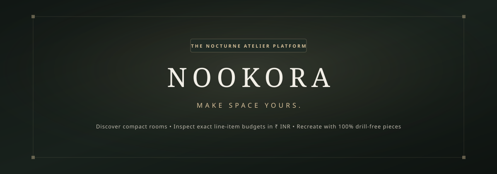
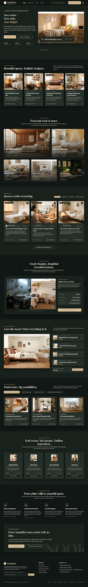
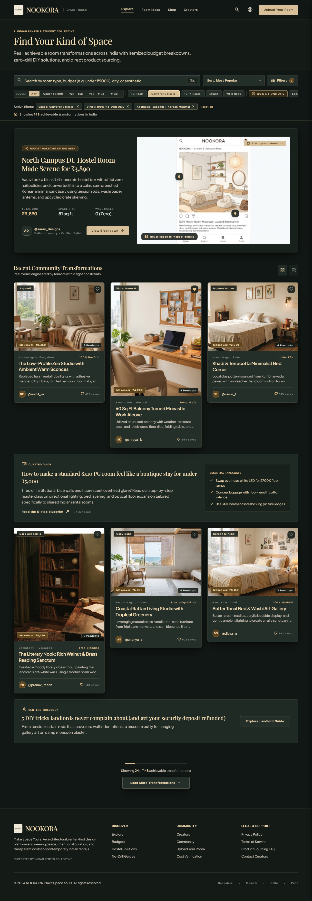
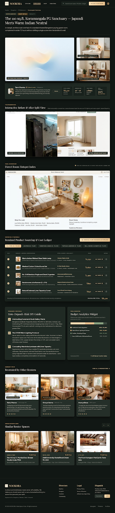
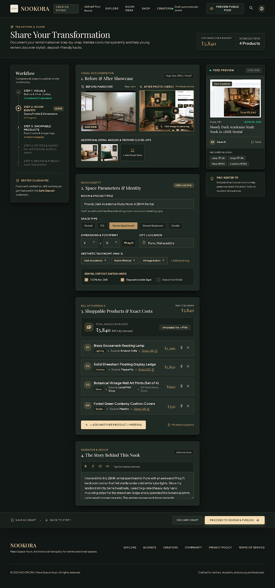
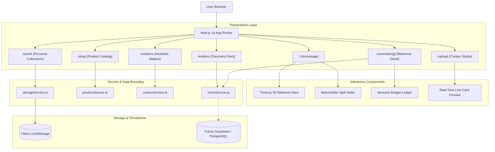

<div align="center">



# NOOKORA
### Make Space Yours.

*"Discover a room. Understand its budget. Find its products. Recreate the look."*

[](https://nextjs.org/)
[](https://react.dev/)
[](https://www.typescriptlang.org/)
[](https://tailwindcss.com/)
[](https://threejs.org/)
[](https://github.com/dchappy20k/Nookora)
[](./LICENSE)

[**Live Demo**](https://sonic-lagoon-5wz16f0.tmp.now) • [**Explore Feed**](https://sonic-lagoon-5wz16f0.tmp.now/explore) • [**Creator Studio**](https://sonic-lagoon-5wz16f0.tmp.now/upload) • [**Documentation**](#documentation)

</div>

---

## 1. Project Overview

**NOOKORA** is a premium room-discovery and affordable home makeover platform that helps renters, students, and young professionals transform compact living spaces without breaking the bank or losing their rental security deposits.

Traditional interior design platforms present opulent, multi-lakh aspirational bedrooms with zero cost transparency or renter compliance. **NOOKORA flips this model**: every featured transformation is budgeted under realistic ceilings (such as **under ₹10,000**), itemized down to the last screwless adhesive bracket in **Indian Rupees (₹)**, and verified to be **100% drill-free**.

### Key Problems Solved
- **The Pinterest Mirage**: Beautiful bedrooms without product lists or price tags are replaced with line-item purchase receipts.
- **Rental Restrictions**: Landlords forbid drilling, nailing, and permanent paint. Nookora specializes in tension rods, Command adhesive hooks, peel-and-stick textures, and warm atmospheric illumination.
- **Budget Opacity**: Transparent financial ledgers show exact costs across IKEA India, Amazon, Westside Home, and FabIndia.

---

## 2. Product Features

###  Cinematic 3D Bedroom Transformation Hero
- Built with **Three.js** and **React Three Fiber** (`@react-three/fiber`, `@react-three/drei`).
- Interactive 5-stage architectural transformation sequence:
  - `01 / Bare Room` → Bare floor and framing
  - `02 / Platform Bed` → Low-profile bed with ochre linen duvet
  - `03 / Desk & Storage` → Floating ash wood study desk and pegboard
  - `04 / Atmospheric Light` → 2700K Akari-style paper floor lantern & backlights
  - `05 / Finished Japandi` → Potted Monstera, wall art, and woven jute rug
- Automatic graceful fallback for mobile devices and users with `prefers-reduced-motion`.

###  Interactive Before-and-After Slider
- Custom split-view comparison slider with real-time pointer/touch dragging, keyboard controls, and status pills.

###  Discovery & Filter Engine (`/explore`)
- Multi-dimensional search across aesthetics (**Japandi**, **Korean Minimal**, **Modern Indian**, **Warm Neutral**, **Gaming Setup**, **Dark Academia**, **Small Space Living**).
- Strict budget ceilings (**Under ₹2,000**, **Under ₹5,000**, **Under ₹10,000**, **Under ₹20,000**).
- Real-time sort controls (price asc/desc, popularity, newest) and a slide-over filter drawer.

###  Room Makeover Detail Pages (`/rooms/[slug]`)
- Spatial metrics (dimensions, square footage, city location).
- Itemized line-item budget ledger with direct links to verified Indian retailers.
- Zero-damage rental techniques and 2700K ambient lighting protocols.
- Similar transformation recommendations.

###  Creator Studio & Upload Wizard (`/upload`)
- 5-step structured publishing workflow:
  1. *Visual Assets* (before/after high-resolution photography)
  2. *Space Specs* (dimensions, square footage, location, style)
  3. *Dynamic Itemized Budget Builder* (real-time price accounting)
  4. *Story & Rental Protocols* (drill-free compliance)
  5. *Verification & Live Preview Card*

###  Saved Collections & Member Profile (`/saved`, `/profile`)
- Client-side persistence via `localStorage` for saved rooms, favorites, and followed stylists.
- Instant total budget estimation across saved mood boards.

---

## 3. Visual Showcase

<div align="center">

### Homepage & 3D Spatial Canvas


### Discovery Feed & Filter System


### Room Makeover Detail & Itemized Budget Ledger


### Creator Studio & Uploader


</div>

---

## 4. Technology Stack

| Domain | Technology | Purpose |
|---|---|---|
| **Framework** | Next.js 14 (App Router) | Server-Side Rendering (SSR) & Static Site Generation (SSG) |
| **Language** | TypeScript 5.6 | Strict end-to-end type safety |
| **Styling** | Tailwind CSS 3.4 | *Nocturne Atelier* custom design tokens & responsive grid |
| **3D Graphics** | Three.js & React Three Fiber | Procedural 3D compact bedroom scene |
| **3D Helpers** | @react-three/drei | Camera orbit controls and rendering performance |
| **Animation** | Framer Motion | Smooth layout animations and slide-over drawers |
| **Iconography** | Lucide React | Accessible, lightweight SVG icon suite |
| **Architecture** | Repository / Service Layer | Decoupled business logic ready for Supabase PostgreSQL |

---

## 5. Architectural Flow



---

## 6. Project Structure

```
nookora/
├── docs/                          # Screenshots, architecture, and design assets
│   └── assets/
│       ├── banner.svg             # Nocturne Atelier brand banner
│       └── screenshots/           # Application screenshots
├── public/                        # Static public assets
├── src/
│   ├── app/                       # Next.js App Router routes
│   │   ├── layout.tsx             # Root layout with fonts, header, footer, toast
│   │   ├── page.tsx               # Editorial homepage (12 sections)
│   │   ├── explore/page.tsx       # Discovery feed & search
│   │   ├── rooms/[slug]/page.tsx  # Makeover detail page
│   │   ├── shop/page.tsx          # Product catalog
│   │   ├── creators/              # Creator directory & profile
│   │   ├── upload/page.tsx        # 5-step Creator Studio
│   │   ├── saved/page.tsx         # Saved room collections
│   │   ├── login/ & signup/       # Authentication interfaces
│   │   └── profile/page.tsx       # Member profile
│   ├── components/                # Modular UI components
│   │   ├── 3d/                    # Three.js canvas & fallback
│   │   ├── common/                # Header, Footer, Slider, Toast, Buttons
│   │   ├── room/                  # RoomCard, BudgetLedger, ProtocolsList
│   │   ├── shop/                  # ProductCard
│   │   ├── creator/               # CreatorCard
│   │   └── upload/                # Dynamic form items
│   ├── data/                      # Verified room, product & creator mock sets
│   ├── services/                  # Decoupled service layer
│   ├── styles/globals.css         # Nocturne Atelier hairline borders & glows
│   └── types/index.ts             # Domain TypeScript definitions
├── LICENSE                        # MIT License
├── PRD.md                         # Product requirements document
├── DESIGN.md                      # Nocturne Atelier design specification
├── ARCHITECTURE.md                # System engineering architecture
├── AGENTS.md                      # Engineering standards & guidelines
├── CONTRIBUTING.md                # Contribution guidelines
├── CHANGELOG.md                   # Version release notes
├── tailwind.config.ts             # Tailwind design token configuration
├── tsconfig.json                  # Strict TypeScript configuration
└── package.json                   # Project scripts and dependencies
```

---

## 7. Getting Started

### Prerequisites
- **Node.js**: v18.18+ or v20+ (tested on Node v22)
- **npm** or **pnpm**

### Installation

1. **Clone the repository:**
   ```bash
   git clone https://github.com/dchappy20k/Nookora.git
   cd nookora
   ```

2. **Install dependencies:**
   ```bash
   npm install
   ```

3. **Configure environment variables:**
   ```bash
   cp .env.example .env.local
   ```

4. **Start the local development server:**
   ```bash
   npm run dev
   ```
   Open [http://localhost:3000](http://localhost:3000) in your browser.

5. **Build for production:**
   ```bash
   npm run build
   npm start
   ```

---

## 8. Documentation

- [**PRD.md**](./PRD.md) — Comprehensive product requirements, user problem definitions, and persona journeys.
- [**DESIGN.md**](./DESIGN.md) — The Nocturne Atelier design specification (colors, typography, radii, spacing).
- [**ARCHITECTURE.md**](./ARCHITECTURE.md) — Detailed technical architecture, rendering strategy, and 3D graphics performance.
- [**AGENTS.md**](./AGENTS.md) — Engineering guidelines, TypeScript requirements, and non-destructive maintenance rules.
- [**CONTRIBUTING.md**](./CONTRIBUTING.md) — Code quality standards, Git commit conventions, and PR workflow.
- [**CHANGELOG.md**](./CHANGELOG.md) — Release notes and milestone history.

---

## 9. Development Roadmap

- [x] Nocturne Atelier dark luxury design system implementation
- [x] 12-section editorial homepage with Google Stitch design fidelity
- [x] Procedural 3D Bedroom Transformation Hero using Three.js & R3F
- [x] Interactive Before-and-After spatial comparison slider
- [x] Multi-facet room discovery feed with budget ceilings and aesthetic tags
- [x] Room detail pages with line-item INR cost ledgers and drill-free protocols
- [x] 5-step Creator Studio makeover upload wizard with live preview
- [x] Product catalog with verified retailer outbound links
- [x] Creator profiles and follow state persistence
- [x] Production build validation (23 static routes prerendered)
- [ ] Supabase PostgreSQL database integration
- [ ] User authentication with Supabase Auth
- [ ] Cloud Storage for creator photo uploads (AWS S3 or Supabase Storage)
- [ ] Retailer affiliate link tracking parameter injection

---

## 10. Contributing

We welcome contributions from designers, renters, and developers. Please review [CONTRIBUTING.md](./CONTRIBUTING.md) before submitting pull requests.

1. Fork the repository.
2. Create your feature branch (`git checkout -b feat/amazing-nook`).
3. Commit your changes using conventional commit messages (`git commit -m 'feat: add filter by square footage'`).
4. Push to the branch (`git push origin feat/amazing-nook`).
5. Open a Pull Request.

---

## 11. License

This project is open-source under the [MIT License](./LICENSE).

---

<div align="center">

**NOOKORA — MAKE SPACE YOURS.**

Built with care for renters, students, and dreamers.

</div>
